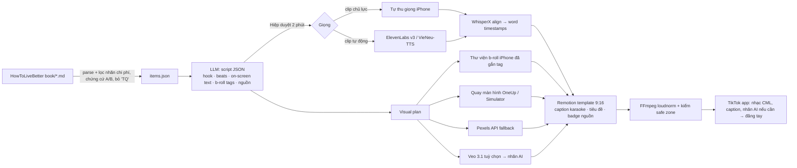

# Nghiên cứu: tự động hoá video ngắn productivity/motivation cho TikTok @hi.oneup

> Kênh TikTok: [@hi.oneup](https://www.tiktok.com/@hi.oneup)

*Soạn ngày 12/10/2026 (giờ VN). Số sao/giấy phép/lần push cuối lấy từ GitHub API cùng ngày. Giá API lấy từ trang giá chính hãng hoặc trang tổng hợp tháng 7–8/2026; chỗ nào chưa tự kiểm thì ghi **(chưa kiểm)**.*

Bối cảnh: Hiệp là SE làm một mình, ~2h/ngày, quay bằng iPhone, có app iOS OneUp (AI companion Omi). Kênh lên tiếng bằng **productivity** trước, sau đó lồng **motivation** rồi tới **app**. Nguồn nội dung là "Cẩm nang sống đáng giá" (HowToLiveBetter).

---

## 1. Nguồn nội dung: HowToLiveBetter

### 1.1 Cấu trúc
- Là bản dịch tiếng Việt của sách tiếng Trung *HowToLiveBetter* (upstream `eternity4719/HowToLiveBetter`). Repo: `chuanman2707/HowToLiveBetter`.
- **34 phần, 672 mục.** Mỗi mục trả lời "bỏ ra gì, nhận lại gì" và có đủ các trường: **Chi phí / Nói dễ hiểu / Lợi ích / Mức chứng cứ (A 438 · B 179 · C 55) / Nguồn sơ cấp / Ghi chú**. Trong mỗi phần, mục được xếp theo hiệu quả chi phí từ cao xuống thấp.
- Mỗi mục có nhãn máy đọc được, ví dụ `<!-- nhan-chi-phi: tien=0 thoi-gian=it y-chi=khong loi-ich=lon ... -->`, nên **lọc tự động được** các mục "không tốn tiền, ít thời gian, không cần ý chí". Có 239 mục mang đúng tổ hợp này. Đây là nguồn rất hợp cho video ngắn.
- **Giấy phép:** phần chữ (book/, docs/) theo **CC BY 4.0**, được dùng cho mục đích thương mại và được cải biên, nhưng bắt buộc: (1) ghi nguồn "Cẩm nang sống đáng giá" (bản tiếng Việt) kèm link repo, (2) kèm link giấy phép CC BY 4.0, (3) ghi rõ là đã chỉnh sửa và đồng bộ theo bản ngày nào. Code dùng MIT.
- **Lưu ý:** nhiều phần về luật, trợ cấp, thủ tục là của Trung Quốc (đánh dấu "Chỉ tham khảo TQ"), gồm các phần 5, 7, 8, 9, 12, 15, 17–19, 21, 24–26... **Không đưa vào video** nếu chưa đối chiếu với Việt Nam.

### 1.2 34 phần, gom theo chủ đề
| Nhóm | Các phần | Hợp với kênh? |
|---|---|---|
| Thời gian & tập trung | 4 Đừng lãng phí thời gian · 3 Đừng lãng phí sức lực | ⭐⭐⭐ Lõi productivity |
| Sức khỏe & năng lượng | 2 Đừng chết từ từ (ngủ, vận động, ngồi lâu, ăn) · 1 Đừng chết sớm · 28 Ngoại hình vs sức khỏe | ⭐⭐⭐ "Năng lượng = nền của năng suất" |
| Tâm trí & thư giãn | 22 Thư giãn thế nào · 3 (mục 14–24: nghĩ quẩn, so sánh, giận) · 29 Sau cú sốc lớn | ⭐⭐⭐ Motivation có chứng cứ |
| Học & sự nghiệp | 23 Học kỹ năng gì đáng · 11 Lằn ranh đỏ dân kỹ thuật · 12 Khởi nghiệp | ⭐⭐ Góc nhìn SE / indie dev |
| Tiền | 5 Đừng lãng phí tiền · 6 Danh sách nên tránh | ⭐⭐ Chỉ chọn mục phổ quát (thuê bao, xổ số, quỹ chỉ số, quỹ dự phòng) |
| An toàn số | 14 Tài khoản & an toàn thông tin | ⭐⭐ Hợp với dân tech |
| Đời sống/pháp lý (TQ) | 7–10, 15–21, 24–27, 30–34 | ⚠️ Để sau, chỉ dùng những mục phổ quát |

### 1.3 Các trụ nội dung đề xuất
1. **"Làm ít, xong nhiều"**: lập kế hoạch, trì hoãn, ước lượng (phần 4).
2. **"Giữ sự tập trung"**: thông báo, đa nhiệm, giờ làm (phần 3).
3. **"Năng lượng là nền"**: ngủ, caffeine, vận động, ngồi lâu (phần 2 và 3).
4. **"Tâm trí vững"**: motivation dựa trên chứng cứ, gỡ myth (phần 3, 22, 6).
5. **"Học & đầu tư vào bản thân"**: cách học, tiền phổ quát, chi phí chìm (phần 23, 5, 4).
6. *(Từ tuần 4)* **"Build OneUp cùng Omi"**: hậu trường indie dev, app là công cụ áp dụng các mục trên.

Công thức mỗi clip (20–40s): **Hook (0–2s) → Myth/vấn đề → 1 hành động cụ thể → "Vì sao" (1 số liệu + mức chứng cứ) → CTA/teaser tập sau**. Overlay ở góc: "Nguồn: Cẩm nang sống đáng giá, phần X mục Y, chứng cứ A".

### 1.4 Hành trình 30 clip đầu (khoảng 5 tuần × 6 clip)
Ký hiệu "4.1" = phần 4, mục 1. Hook viết tiếng Việt; bản EN dịch lại sau.

**Tuần 1: Làm ít, xong nhiều (phần 4)**
| # | Mục | Hook |
|---|---|---|
| 1 | 4.1 Viết "định làm" thành "mấy giờ, ở đâu, gặp gì thì làm gì" | "Đổi đúng 1 câu, tỷ lệ làm được tăng rõ (94 nghiên cứu)." |
| 2 | 4.9 Trì hoãn là né cảm giác khó chịu | "Bạn không lười. Bạn đang né một cảm giác." |
| 3 | 4.7 Chia việc lớn thành việc con rồi mới ước giờ | "Task 'làm app' không bao giờ xong. Đây là lý do." |
| 4 | 4.4 Ước thời gian theo dữ liệu quá khứ | "Dev nào estimate cũng sai x2. Cách sửa trong 30 giây." |
| 5 | 4.8 Việc không có deadline thì tự đặt ngày | "Việc không có deadline = việc không tồn tại." |
| 6 | 4.12 Thói quen tính theo tháng, không phải "21 ngày" | "21 ngày tạo thói quen là myth." *(cầu nối tự nhiên sang OneUp về sau)* |

**Tuần 2: Giữ sự tập trung (phần 3 và 4)**
| # | Mục | Hook |
|---|---|---|
| 7 | 3.1 Tắt thông báo, điện thoại ngoài tầm mắt | "Điện thoại úp mặt bàn vẫn ăn sự tập trung của bạn." |
| 8 | 3.5 Xử lý email/tin nhắn theo đợt | "Mình chỉ check Slack 3 lần/ngày, và chẳng ai chết." |
| 9 | 3.7 Mỗi lúc một việc | "Vừa họp vừa reply = làm 2 việc dở." |
| 10 | 3.6 Chặn cả ngắt vài giây | "Một cái liếc 3 giây đắt hơn bạn nghĩ." |
| 11 | 3.13 Quá ~49h/tuần, giờ làm thêm cho ra ít hơn | "Làm 60h/tuần không giúp bạn ra 60h sản phẩm." |
| 12 | 4.15 Giới hạn cứng cho video ngắn | "Video này nên là video cuối bạn xem hôm nay." *(hook nghịch lý)* |

**Tuần 3: Năng lượng là nền (phần 2 và 3)**
| # | Mục | Hook |
|---|---|---|
| 13 | 4.17 Học phím tắt & tự động hoá | "Mình tiết kiệm 1 tiếng/tuần nhờ 5 phím tắt." |
| 14 | 3.2 Cố định giờ dậy, cả cuối tuần | "Ngủ bù cuối tuần đang phá thứ 2 của bạn." |
| 15 | 3.3 Đừng coi 6 tiếng là đủ | "Bạn nghĩ mình quen ngủ 6 tiếng. Não bạn không nghĩ vậy." |
| 16 | 3.4 Không caffeine sau 2h chiều | "Ly cà phê 3h chiều = 1 giờ ngủ sâu biến mất." |
| 17 | 3.11 Buồn ngủ chiều thì chợp 10 phút | "Ngủ trưa 30 phút làm bạn mệt hơn." |
| 18 | 2.17 / 2.11 Đừng ngồi liền, đi đủ 7–8k bước | "Dev ngồi 10 tiếng/ngày: 1 thói quen bù lại." |

**Tuần 4: Tâm trí vững / motivation (phần 3, 22, 6)**, bắt đầu nhắc nhẹ tới app
| # | Mục | Hook |
|---|---|---|
| 19 | 6.25 Đừng tin "ý chí như cơ bắp, dùng là hết" | "Ý chí không cạn như pin. Myth này đang hại bạn." |
| 20 | 3.20 Đừng đọc "đời người khác" mỗi ngày | "Bạn bè cùng tuổi giỏi hơn? Tắt cái app này đi." |
| 21 | 3.21 Thấy "ai cũng nhìn mình mất mặt" thì chia đôi ước tính | "Không ai để ý bạn nhiều như bạn tưởng." |
| 22 | 22.8 "Thở dài vòng" 5 phút | "Bình tĩnh lại trong 5 phút, không cần app thiền." |
| 23 | 22.6 Tâm trạng kém thì đi bộ/chạy | "Buồn thì đi bộ: hiệu quả tỷ lệ với cường độ." |
| 24 | 3.14 Nghĩ quẩn thì chuyển sang việc phải động tay | "Đang overthinking? Rửa chén đi. Thật." |

**Tuần 5: Học & đầu tư vào bản thân, giới thiệu Omi**
| # | Mục | Hook |
|---|---|---|
| 25 | 23.14 Học xong gấp sách tự kiểm, đừng đọc lại | "Đọc lại 3 lần = cách học tệ nhất." |
| 26 | 23.15 Dàn việc học ra nhiều ngày | "Học 1 tiếng × 1 ngày < 15 phút × 4 ngày." |
| 27 | 4.3 Chi phí chìm | "Đã làm side project 6 tháng nên phải làm tiếp? Sai." |
| 28 | 5.1 Tắt mọi gia hạn tự động | "Bạn đang trả tiền cho 3 app không dùng." |
| 29 | 14.10 Đừng đưa source/key cho "trạm trung chuyển AI" lạ | "Dev ơi, đừng dán API key vào đây." |
| 30 | Tổng kết + OneUp | "30 ngày, 30 thói quen có chứng cứ. Mình build app để tự nhắc mình: gặp Omi." |

**Lồng app theo giai đoạn:** Tuần 1–2 không nhắc app (chỉ để xây lòng tin). Tuần 3–4 thêm b-roll màn hình OneUp 2–3 giây ("mình track bằng app tự làm"). Từ tuần 5, Omi xuất hiện như một nhân vật, ví dụ Omi "đọc" phần Ghi chú/chứng cứ, tạo series "Omi nhắc bạn". Gợi ý dàn ý cho series dài hạn: mỗi trụ là một playlist TikTok.

---

## 2. Thư viện & công cụ (kiểm 12/10/2026)

### 2.1 Dựng video bằng code
| Công cụ | ⭐ GitHub | License | Ngôn ngữ | Push cuối | Mạnh ở | Yếu ở | Hợp với Hiệp |
|---|---|---|---|---|---|---|---|
| **Remotion** (remotion-dev/remotion) | 63.4k | Remotion License: **miễn phí cho cá nhân và tổ chức ≤3 người**, kể cả thương mại hay tự động hoá; từ 4 người: $25/seat/tháng hoặc $0.01/render (tối thiểu $100/tháng) | TS/React | 11/10/2026 | Template bằng React, Studio xem trước, có sẵn caption kiểu TikTok (`@remotion/captions`, `createTikTokStyleCaptions`, `@remotion/install-whisper-cpp`), hệ sinh thái lớn | Cần biết React; render dùng Chrome headless nên khá nặng | ✅ **Chọn.** Chạy được cả trên Mac M và trên box |
| Motion Canvas | 19.3k | MIT | TS | 02/07/2026 | Animation vector/giải thích đẹp | Thiên về editor, khó tự động hoá hàng loạt | Tuỳ chọn |
| Revideo (giờ là `midrender/revideo`) | 4.1k | MIT | TS | 15/07/2026 | Fork Motion Canvas, render headless bằng API | Cộng đồng nhỏ, đã đổi chủ | Phương án thay thế |
| MoviePy | 15.0k | MIT | Python | 26/08/2026 | Ghép clip bằng Python, nhanh gọn | Chữ/animation đẹp thì khó, v2 thay đổi API | Hợp cho script phụ |
| FFmpeg | 65.0k (mirror) | LGPL/GPL | C | 12/10/2026 | Cắt, scale 9:16, chuẩn hoá loudness, burn sub | CLI khó đọc | ✅ Luôn dùng kèm |
| editly | 5.5k | MIT | TS | 12/05/2025 | Video từ JSON khai báo | Ít hoạt động | Không ưu tiên |

### 2.2 Pipeline/template "chủ đề → video"
| Repo | ⭐ | License | Push cuối | Cách hoạt động | Nhận xét |
|---|---|---|---|---|---|
| MoneyPrinterTurbo | 129.9k | MIT | 12/10/2026 | LLM viết kịch bản → stock Pexels/Pixabay → edge-tts/Azure → phụ đề → MoviePy; có WebUI và API | Phổ biến nhất, dễ thử. Tiếng Việt có lẽ qua giọng edge-tts **(chưa kiểm)**. Ra video kiểu "stock footage + giọng AI", dễ ra nội dung chung chung. README có nhiều link tài trợ |
| MoneyPrinter (bản gốc) | 14.0k | MIT | 26/03/2026 | Tương tự, đơn giản hơn | Ít cập nhật |
| ShortGPT | 8.0k | MIT | 10/02/2025 | Framework tự động hoá shorts | Gần như ngưng (2025) |
| short-video-maker (gyoridavid) | 1.4k | MIT | 21/06/2025 | Kokoro TTS + Whisper + Pexels + **Remotion**, có REST/MCP, dùng được với n8n | Kiến trúc rất giống stack đề xuất. Kokoro **không có tiếng Việt**. Hợp để đọc code hoặc fork làm khung |

→ **Kết luận:** dùng các repo này để học và thử nhanh 1 buổi, không dùng làm sản phẩm. Chúng tối ưu cho video "faceless" sản xuất hàng loạt, ngược với định vị "SE thật, app thật" của @hi.oneup.

### 2.3 TTS (Việt + Anh)
| Công cụ | ⭐ / trạng thái | License | Tiếng Việt | Chi phí | Nhận xét |
|---|---|---|---|---|---|
| **Giọng thật của Hiệp (iPhone + mic cài áo)** | n/a | n/a | ✅ tốt nhất | 0đ | Chân thật, không cần nhãn AI. ~5 phút/clip |
| **ElevenLabs v3** | SaaS | Thương mại từ gói Starter $6/tháng (30k credit); API v3 khoảng $0.08–0.10/1k ký tự (hai trang giá ghi khác nhau) | ✅ (v3 và Flash v2.5 có VIE) | ~1 clip 40s ≈ 600 ký tự ≈ $0.05–0.06 | Biểu cảm tốt, có voice clone giọng mình. Chất lượng giọng Việt cần nghe thử **(chưa kiểm)** |
| **VieNeu-TTS v3 Turbo** (pnnbao97) | 2.8k, push 12/10/2026 | Apache-2.0 (bản v4 là API đóng) | ✅ chuyên tiếng Việt, song ngữ | 0đ, chạy được CPU (~2× real-time theo README) | 25 giọng có sẵn, clone từ 3–8s, có API tương thích OpenAI. **Lựa chọn open-source số 1 cho tiếng Việt** |
| edge-tts | 12.2k | LGPL-3.0 (GitHub ghi "Other") | ✅ `vi-VN-HoaiMyNeural`, `vi-VN-NamMinhNeural` (đã kiểm); EN: Andrew/Ava/Brian/Emma Multilingual | 0đ | Nhanh, ổn định, hợp để làm prototype. Gọi endpoint không chính thức của Microsoft Edge nên rủi ro ToS hoặc bị chặn; giọng Việt hơi "đọc tin" |
| F5-TTS | 15.4k | Code MIT, **weights gốc CC-BY-NC** **(chưa kiểm lại)** | Có fine-tune VI từ cộng đồng | GPU | Clone tốt, nhưng license weight hạn chế thương mại |
| Coqui TTS / XTTS-v2, viXTTS | 46.1k, **ngưng từ 08/2024**; vixtts-demo 518 | MPL-2.0 code; model XTTS theo CPML (phi thương mại) | viXTTS: ✅ | GPU | Không khuyên dùng: công ty đã đóng, license model phi thương mại |
| Piper | rhasspy/piper **archived**; tiếp tục ở OHF-Voice/piper1-gpl (5.8k, GPL-3.0) | GPL-3.0 | Có giọng vi_VN, chất lượng thấp **(chưa kiểm)** | 0đ, rất nhẹ | Hợp đọc thông báo, không hợp TikTok |
| Kokoro | 9.3k | Apache-2.0 | ❌ | 0đ | Chỉ dùng cho bản EN |
| CosyVoice (QwenAudio) | 23.9k | Apache-2.0 | Đa ngôn ngữ, tiếng Việt **(chưa kiểm)** | GPU | Để thử sau |
| Chatterbox, fish-speech | 26.9k MIT · 33.0k (license riêng) | — | **(chưa kiểm)** | GPU | Chủ yếu EN/zh |
| mlx-audio | 8.0k, MIT | — | Tuỳ model | Mac M | Chạy TTS/STT trên Apple Silicon |

### 2.4 Phụ đề tự động / caption karaoke theo từng từ
| Công cụ | ⭐ | License | Ghi chú |
|---|---|---|---|
| openai/whisper | 110.3k | MIT | Gốc, chậm |
| **faster-whisper** | 25.8k | MIT | Nhanh trên CPU (box) |
| **WhisperX** | 24.5k | BSD-2 | Word-level timestamp chuẩn nhờ forced alignment. Có sẵn model căn chỉnh tiếng Việt `nguyenvulebinh/wav2vec2-base-vi-vlsp2020` (đã kiểm trong mã nguồn) |
| **whisper.cpp** | 54.3k | MIT | Chạy Metal trên Mac M; Remotion có `@remotion/install-whisper-cpp` + `toCaptions()` |
| stable-ts | 2.3k, **archived** | MIT | Bỏ qua |
| vibe | 7.8k | MIT | App GUI phiên âm offline |

Mẹo: đã có sẵn kịch bản thì **căn chỉnh (align) kịch bản với audio** thay vì để Whisper đoán chữ. Cách này giúp dấu tiếng Việt đúng 100%. Dùng model `large-v3`/`large-v3-turbo` cho tiếng Việt.

### 2.5 Sinh video/ảnh bằng AI
| Model | ⭐ / giá | License | Phần cứng | Nhận xét |
|---|---|---|---|---|
| Wan 2.2 / 2.1 | 17.9k / 17.2k | Apache-2.0 | GPU NVIDIA ~24GB (bản 5B). Trên Mac rất chậm | Open tốt nhất về license |
| HunyuanVideo | 12.6k | Tencent community license (có giới hạn lãnh thổ/quy mô) **(chưa kiểm)** | GPU lớn | — |
| LTX-Video / LTX-2 | 11.1k (Apache-2.0) / 9.7k (license riêng) | — | GPU tầm trung | Nhanh. API LTX-2.3 Fast khoảng $0.06/s |
| CogVideoX | 13.1k | Apache-2.0 | GPU | Đã cũ (push cuối 11/2025) |
| ComfyUI | 137.0k | GPL-3.0 | — | Giao diện node để chạy các model trên |
| **Veo 3.1** (Google API) | Lite ~$0.05/s (720p), Fast $0.10–0.12/s, Standard $0.40/s; có audio | Thương mại | Cloud | Veo 2/3 cũ đã dừng 30/06/2026 |
| Kling 3.0 | ~$0.08–0.17/s tuỳ độ phân giải/audio | Thương mại | Cloud | — |
| Runway | Gen-4 Turbo $0.05/s, Gen-4.5 $0.12/s | Thương mại | Cloud | — |
| Sora 2 API | — | — | — | **Các nguồn tổng hợp ghi API đã đóng 24/09/2026** **(chưa kiểm từ OpenAI)**, đừng dùng |

**Box hiện tại không có GPU** (8 core, 15GB RAM), nên không chạy được model video open-source trên box. Nếu cần b-roll AI thì gọi API (Veo 3.1 Lite/Fast), mỗi clip chỉ 1–2 cảnh dài 4–8s ≈ $0.2–1.

### 2.6 Stock footage & nhạc
- **Pexels API:** miễn phí, mặc định 200 request/giờ và 20.000/tháng; không bắt buộc ghi nguồn nhưng nên ghi. **Pixabay API** tương tự (Pixabay Content License) **(chưa kiểm chi tiết 2026)**.
- **Nhạc:** an toàn nhất là **thêm nhạc trong app TikTok** lúc đăng. Nếu đăng với tư cách app/brand (quảng bá OneUp) thì **chỉ dùng Commercial Music Library**. CML chỉ có hiệu lực trên TikTok, đăng lại lên Reels/Shorts cần license riêng. Muốn render sẵn nhạc trong file thì dùng nhạc có license rõ (Pixabay Music, Eleven Music $0.15/phút, hoặc tự làm).

---

## 3. Stack & pipeline đề xuất

### 3.1 Stack
| Khâu | Chọn | Dự phòng |
|---|---|---|
| Nguồn | Parse `book/*.md` (Python), lọc theo nhãn `tien=0, y-chi=khong` và chứng cứ A/B, bỏ mục "Chỉ tham khảo TQ" | — |
| Kịch bản | LLM bất kỳ (Claude/GPT/Gemini/Grok) xuất **JSON**: hook, beats[], on-screen text, b-roll keywords, nguồn | — |
| Giọng | **Giọng thật** cho clip chủ lực; **ElevenLabs v3** (clone giọng mình) cho clip tự động | VieNeu-TTS v3 Turbo (miễn phí, offline); edge-tts để prototype |
| Phụ đề | **WhisperX** (align kịch bản, VI/EN) trên box, hoặc whisper.cpp trên Mac | faster-whisper |
| Hình | iPhone b-roll + quay màn hình OneUp + kinetic typography; Pexels làm phương án dự phòng | Veo 3.1 Lite/Fast cho cảnh trừu tượng (gắn nhãn AI) |
| Dựng | **Remotion** (template 1080×1920, 30fps, caption karaoke bằng `createTikTokStyleCaptions`) | — |
| Hậu kỳ | FFmpeg: loudnorm −14 LUFS, kiểm 9:16, chừa safe zone UI TikTok | — |
| Đăng | Thêm nhạc + caption + hashtag trong app TikTok, **đăng thủ công** | — |

Chi phí: ~0–10 USD/tháng (ElevenLabs Starter $6 + vài clip Veo nếu cần). Remotion miễn phí vì Hiệp là cá nhân.

### 3.2 Sơ đồ

### 3.3 Chỗ cho footage iPhone và OneUp
- **Thư viện b-roll:** mỗi tuần dành 1 buổi (30–45 phút) quay 20–30 shot dọc 4K/30fps, mỗi shot 3–6s: bàn làm việc, gõ phím, úp điện thoại, đi bộ, rót cà phê, đồng hồ, sổ tay. Đặt tên file theo tag (`focus_phone-facedown_01.mov`) để pipeline tự chọn theo b-roll tags.
- **Talking head:** clip chủ lực thì quay mặt 1 lần cho phần hook (2–3s đầu). Mặt người thật giúp giữ người xem và không cần nhãn AI.
- **OneUp:** dùng iOS Screen Recording, hoặc `xcrun simctl io booted recordVideo` trên Simulator (sạch, không có status bar thật). Remotion đặt vào khung iPhone mockup, zoom vào nút hoặc streak. Omi có thể là avatar 2D xuất hiện góc màn hình ở series "Omi nhắc bạn".
- **Ngân sách thời gian:** quay thư viện 1 lần/tuần, sau đó mỗi clip ~15–25 phút (duyệt script, thu giọng, sửa caption, đăng). Với 2h/ngày thì làm được 3–5 clip/ngày nếu cần, 1 clip/ngày là thoải mái.

### 3.4 Lộ trình xây (khoảng 2 tuần, mỗi tối 2h)
1. Ngày 1–2: script Python parse book → `items.json`, prompt LLM ra script JSON.
2. Ngày 3–5: template Remotion (hook, caption karaoke, badge nguồn, outro), chạy thử với edge-tts.
3. Ngày 6–7: WhisperX align tiếng Việt, sau đó thay giọng bằng ElevenLabs hoặc VieNeu, nghe so sánh.
4. Tuần 2: thư viện b-roll, chọn b-roll theo tag, Pexels fallback, xuất batch 6 clip của tuần 1.

## 4. Rủi ro & lưu ý
| Rủi ro | Mức | Cách giảm |
|---|---|---|
| **Nhãn AI trên TikTok**: bắt buộc gắn nhãn cho nội dung AI *trông thật* (người, cảnh, giọng). TikTok tự gắn nhãn khi file có C2PA (Veo, Runway... thường nhúng C2PA) và nhãn tự động **không gỡ được**. Theo TikTok, gắn nhãn không ảnh hưởng phân phối | Trung bình | Ưu tiên footage thật. Giọng AI clone/giọng giống người thật thì tự bật nhãn "AI-generated". Đừng làm người hay chuyên gia giả |
| **Giọng Việt AI** nghe máy móc, sai dấu, ngắt nhịp lạ, người xem dễ lướt qua | Cao | Giọng thật cho clip chủ lực. Luôn nghe lại. Viết script câu ngắn, tránh viết tắt, số viết thành chữ |
| **Nhạc**: bị tắt tiếng hoặc gỡ nếu dùng nhạc không đúng license trong nội dung quảng bá app | Trung bình | Dùng CML trong app. Khi lên cross-post thì đổi nhạc |
| **Stock/AI footage**: người trong ảnh Pexels không được hiểu là đang "xác nhận" sản phẩm. Weights F5/XTTS phi thương mại | Thấp–TB | Đọc license từng model. Không dùng stock có người cạnh logo OneUp |
| **Nội dung sức khỏe/tài chính**: dễ bị coi là lời khuyên y tế; sách có phần luật TQ | Trung bình | Chỉ dùng mục chứng cứ A/B, nói "nghiên cứu cho thấy", ghi nguồn, bỏ mục TQ, không đưa liều thuốc |
| **CC BY 4.0**: thiếu ghi nguồn là vi phạm | Thấp | Bio/caption: "Nội dung chuyển thể từ 'Cẩm nang sống đáng giá' (github.com/chuanman2707/HowToLiveBetter), CC BY 4.0, đã chỉnh sửa, bản ngày …" |
| **Trông như "AI slop"** hay spam template, reach thấp | Cao | Mỗi clip có ít nhất 1 yếu tố thật (mặt, tay, app, câu chuyện của mình). Không đăng hàng loạt |
| edge-tts dùng endpoint không chính thức | Thấp | Chỉ dùng để prototype |

## 5. Nguồn chính
- HowToLiveBetter: https://chuanman2707.github.io/HowToLiveBetter/ · https://github.com/chuanman2707/HowToLiveBetter
- Remotion license FAQ: https://www.remotion.dev/docs/license/faq · Captions: https://www.remotion.dev/docs/captions/create-tiktok-style-captions
- TikTok AIGC: https://support.tiktok.com/en/using-tiktok/creating-videos/ai-generated-content · CML: https://ads.tiktok.com/help/article/commercial-music-library
- ElevenLabs: https://elevenlabs.io/pricing/api · model/ngôn ngữ: help.elevenlabs.io (bài "What models do you offer")
- Giá video AI (tổng hợp, 07–08/2026): awesomeagents.ai/pricing/video-generation-pricing, aitachyon.com/blog/ai-video-generation-api-pricing
- Pexels API: https://www.pexels.com/api/documentation
- Repo: GitHub API, 12/10/2026
